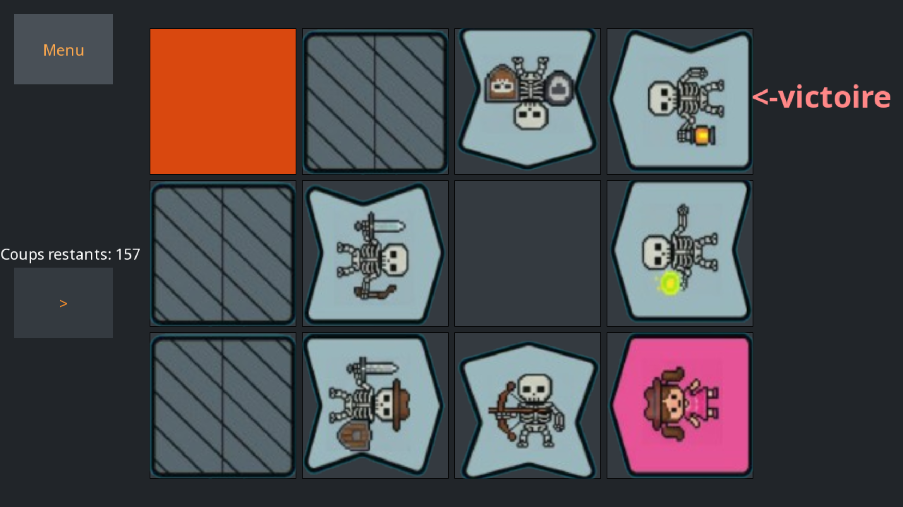

# Tombe Frayeur (Projet étudiant)

Adaptation non officielle en C et SDL3 inspirée du jeu de logique **Tombe Frayeur** (*Graveyard Shift*, édité par SmartGames), réalisée dans le cadre d'un projet de fin de semestre à l'ESIEA.

> Ce projet est strictement éducatif et non commercial, sans aucune affiliation avec SmartGames.



## Le jeu

Sur un plateau de **3 × 4 cases**, vous devez aider le personnage principal à sortir du cimetière en atteignant la case de sortie en haut à droite.

* **Tombes** : obstacles fixes (jusqu'à 3 sur le plateau).
* **Squelettes** : pièces mobiles de formes différentes (jusqu'à 7) qu'il faut déplacer et faire pivoter sans jamais faire se chevaucher leurs bordures ni sortir de la grille.

### Fonctionnalités

* **Solveur intégré (BFS)** : calcule la solution optimale en nombre de coups et peut jouer le prochain coup pour aider le joueur.
* **Générateur de niveaux** : génération aléatoire par nombre de squelettes/tombes ou par niveau de difficulté (`EASY`, `NORMAL`, `HARD`).
* **Éditeur de niveaux** : création et test de plateaux personnalisés directement en jeu.

### Commandes

* **Clic droit** sur un squelette : sélectionner la pièce (affiche un aperçu).
* **Flèches directionnelles** : déplacer l'aperçu d'une case.
* **R / T** : rotation horaire / anti-horaire (90°).
* **Espace** : valider le déplacement.
* **Échap** : quitter.

---

## Compiler et lancer

### Windows (Visual Studio / MSVC)

Le dépôt inclut les bibliothèques SDL3 (`x64`) dans `third_party/`.

1. Ouvrir le dossier `Tombe-Frayeur-SDL3` dans **Visual Studio** (détection automatique de `CMakeLists.txt`).
2. Sélectionner la cible `application` et lancer avec **F5** ou **Ctrl+F5**.

### Linux (GCC / CMake)

Installer les paquets de développement SDL3, par exemple sur Fedora :

```bash
sudo dnf install SDL3-devel SDL3_image-devel SDL3_ttf-devel
```

Ou sur Ubuntu / Debian (selon la disponibilité des paquets SDL3) :

```bash
sudo apt install libsdl3-dev libsdl3-image-dev libsdl3-ttf-dev
```

Puis compiler et exécuter depuis `out/build/application` (pour que le chemin relatif vers `assets/` soit valide) :

```bash
cmake -B out/build
cmake --build out/build -j4
cd out/build/application && ./application
```

---

## Tests unitaires

Une suite de tests pour le noyau (`game_core`, `hash_map`, `game_solver`, `game_levels`) est disponible dans `tests/test_core.c` :

```bash
gcc -std=c11 -Wall -Iapplication/src -Iengine/src \
    -Ithird_party/SDL3-3.2.8/include \
    -Ithird_party/SDL3_image-3.2.4/include \
    -Ithird_party/SDL3_ttf-3.1.0/include \
    tests/test_core.c \
    application/src/game/core/game_core.c \
    application/src/game/core/hash_map.c \
    application/src/game/core/game_solver.c \
    application/src/game/core/game_levels.c \
    -lm -o test_core && ./test_core
```

---

## Structure du projet

```text
Tombe-Frayeur-SDL3/
├── application/   # Code du jeu (noyau, solveur, niveaux, rendu, UI)
├── engine/        # Moteur 2D SDL3 (renderer, assets, caméra, UI)
├── assets/        # Assets générés (.dat)
├── assets_dev/    # Assets sources (PNG, JSON, TTF)
├── third_party/   # SDL3, SDL3_image, SDL3_ttf (Windows x64) et cJSON
└── tests/         # Tests unitaires C
```

## Licence

Ce projet est distribué sous licence MIT. Voir le fichier [LICENSE.md](LICENSE.md).

